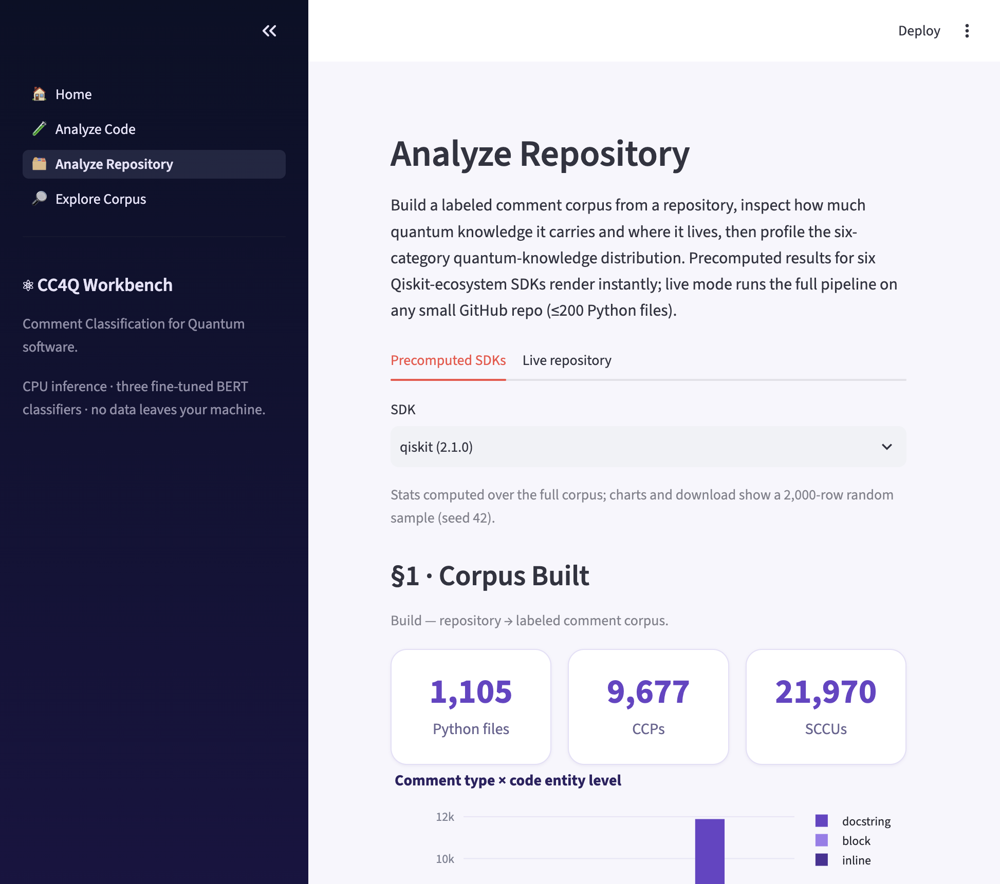
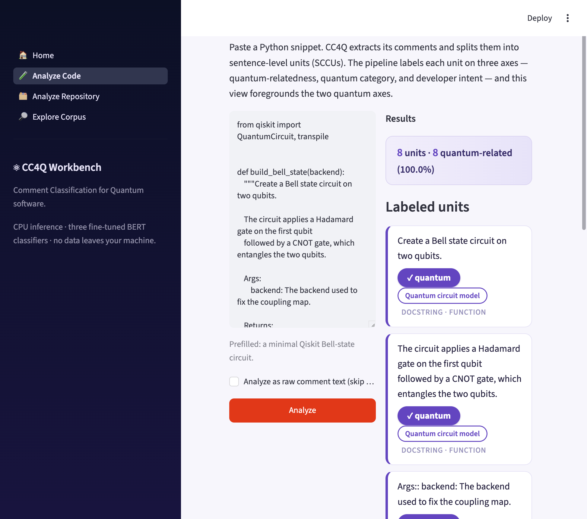

# CC4Q Workbench — Building and Analyzing Quantum Code Comment Corpora

[](https://github.com/MaxwelsDonc/cc4q-workbench/actions/workflows/ci.yml)

**Turn any Python-based quantum SDK repository into a labeled code-comment
corpus, then inspect and profile its quantum knowledge.**

CC4Q Workbench is the tool companion of *"Code Comments for Quantum Software
Development Kits: An Empirical Study on Qiskit"* (TOSEM, accepted). It
packages that study's methodology as a reusable tool:

- a **corpus-construction pipeline**: repository → code-comment pairs (CCPs)
  → sentence-level comment units (SCCUs);
- three released **fine-tuned BERT classifiers** (quantum-relatedness,
  developer intent, quantum-knowledge category);
- a four-page **web workbench**: live snippet labeling, repository
  dashboards, cross-SDK comparison, corpus exploration.

<p align="center">
  
  
</p>

## Try it

**Option 1 — Docker (easiest; nothing to install beyond Docker):**

```bash
docker build -t cc4q-workbench .
docker run -p 8501:8501 cc4q-workbench     # open http://localhost:8501
```

The image bundles the workbench, the pipeline, and precomputed results for
six Qiskit-ecosystem SDKs; classifier checkpoints are fetched at container
start (SHA256-verified). GPU hosts: build with
`docker build --build-arg TORCH_CHANNEL=cu126 -t cc4q-workbench:gpu .` and run
with `--gpus all`; the app auto-detects CUDA. (We develop on Apple Silicon,
so the GPU flavor is currently untested by us — feedback welcome.)

**Option 2 — local install** (requires **Python ≥ 3.11**):

```bash
git clone https://github.com/MaxwelsDonc/cc4q-workbench.git
cd cc4q-workbench
conda create -n cc4q python=3.11 -y && conda activate cc4q
# or: python3.11 -m venv .venv && source .venv/bin/activate
#     (Windows PowerShell: .venv\Scripts\Activate.ps1)

pip install -r requirements.txt
python -m spacy download en_core_web_sm

# the web workbench
pip install -r demo/requirements-demo.txt
streamlit run demo/app.py

# the pipeline on bundled examples
python scripts/02_extract_code_comment_pairs.py config/examples.yaml
python scripts/03_segment_comments.py config/examples.yaml
```

Only trying the pipeline, not the classifiers? A lean install suffices:
`pip install libcst==1.8.2 pyyaml loguru tqdm docutils==0.21.2 sphinx==8.2.3 spacy==3.8.7 nltk`.

**Classifier checkpoints** (~1.2 GB, needed for the Analyze pages and for
labeling new corpora):

```bash
python scripts/download_models.py            # download + verify + extract
python scripts/download_models.py --check    # verify only
```

Everything else works without them.

## Tests

One command runs the test suite (pytest is in `demo/requirements-demo.txt`):

```bash
pip install pytest   # plus: pip install -r demo/requirements-demo.txt for the app tests
pytest
```

- `tests/test_data.py` — demo-data integrity, packaging checks, and the
  snippet pipeline (no checkpoints needed; same checks CI runs via
  `python demo/smoke_test.py`).
- `tests/test_segmenters.py` — unit tests for the three comment segmenters.
- `tests/test_models_and_app.py` — three-axis classification and Streamlit
  page rendering; **skipped automatically** when `models_checkpoints/` is
  absent.

`demo/smoke_test.py` remains the CI entry point; `scripts/test_segment.py`
is a runnable usage example for the segmenters.

## Repository layout

```
demo/           the web workbench (Streamlit) + precomputed dashboards
scripts/        pipeline entry points (download → extract → segment) + model download
parser_core/ segment_core/ utils/ config/   pipeline libraries & per-SDK configs
model/          classifier training code, training data, label mappings
examples/       tiny sample sources for the quick start
exp/            tool-paper validation evidence (see exp/README.md)
rqs/            companion study's analysis scripts and results
doc/            labeling guideline + workbench design document
```

## Documentation

- `doc/workbench_design.md` — the workbench's design specification
  (pages, analyses, acceptance criteria)
- `doc/Guideline_for_labelling_training.md` — the annotation guideline used
  in the companion study
- `exp/README.md` — the validation data behind the tool paper's numbers

## Companion corpus

The companion study's gold corpus (28,076 human-validated units from
`qiskit` 2.1.0, `qiskit-aer` 0.17.2, `qiskit-ibm-runtime` 0.45.1) is archived
separately (see the companion paper's artifact link; too large for git).
Each unit is a JSON object:

| Field | Description |
| --- | --- |
| `id` | unit id; the numeric prefix is the id of its parent comment pair |
| `SDK`, `version` | source library and pinned version |
| `dirPath`, `comment_line`, `code_line` | location in the upstream repository |
| `comment_type` | `docstring` / `block` / `inline` |
| `comment_text`, `code_snippet` | the comment text and its associated code |
| `code_entity_type` | `module` / `class` / `function` |
| `is_quantum_specific` | whether the unit is quantum related |
| `developer_intent_category` | `what` / `why` / `how-to-use` / `how-it-is-done` / `property` / `developer-others` |
| `quantum_specific_category` | one of six quantum-knowledge categories (quantum-specific units only) |

## Reproducing the analyses

Build a corpus for a new SDK: add an entry to `config/repo_list.yaml`
(`url` + pinned `ref`), run `scripts/01_download_repos.py`, then scripts
`02`/`03` with a per-SDK config (see `config/config_qiskit.yaml`), then label
with `exp/run_inference.py`. The companion study's RQ analyses live in
`rqs/`, and the tool paper's generalization/verification numbers in `exp/`;
both directories contain step-by-step notes.

## License & attribution

Code and annotations: MIT (see `LICENSE`). Comment/code content is extracted
from the Qiskit projects (Apache-2.0); the classifiers are derived from
`bert-base-uncased` (Apache-2.0). If you use this artifact, please cite the
companion paper.

## Citation

```bibtex
@article{cc4q2026tosem,
  author  = {Zhou, Zenghui and Li, Yuechen and Cai, Yi and Wen, Jinlong and Yu, Xiaohan and Zheng, Zheng and Yin, Beibei},
  title   = {Code Comments for Quantum Software Development Kits: An Empirical Study on Qiskit},
  journal = {ACM Transactions on Software Engineering and Methodology},
  year    = {2026},
  note    = {Accepted for publication}
}
```

