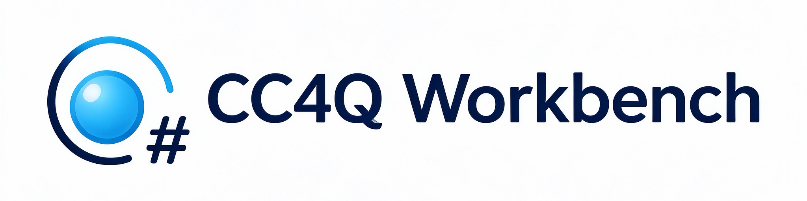
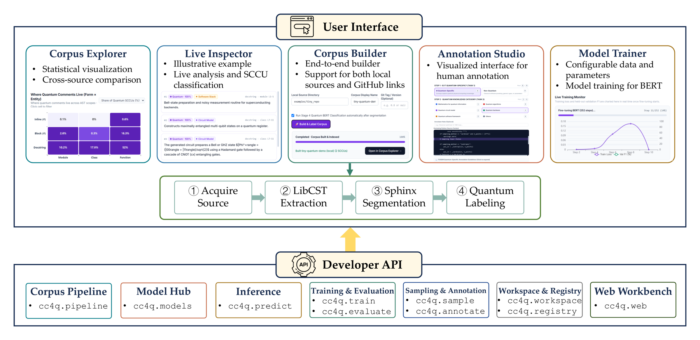

<p align="center">
  
</p>

<p align="center"><b>Building, Verifying, and Adapting Quantum Code Comment Corpora</b></p>

[](https://github.com/MaxwelsDonc/cc4q-workbench/actions/workflows/ci.yml)
[](https://www.python.org/downloads/)
[](LICENSE)
[](#citation)

> Turn any Python-based quantum SDK repository into a labeled, source-linked code-comment corpus — then explore, verify, and fine-tune on it.

Studying comments in a new quantum SDK used to mean rebuilding three things from scratch: a comment extractor, quantum-specific classifiers, and a manual-checking workflow. CC4Q Workbench packages all three as a four-stage pipeline (acquire → extract → segment → label), an interactive five-tab web studio, and an equivalent CLI/Python API. It operationalizes the methodology of our [ACM TOSEM companion study](#citation).



---

## Contents

- [Quick start](#quick-start)
- [What it does](#what-it-does)
- [The five studios](#the-five-studios)
- [Command-line interface](#command-line-interface)
- [Released corpora & benchmark](#released-corpora--benchmark)
- [Repository layout](#repository-layout)
- [Citation](#citation)
- [License](#license)

---

## Quick start

Requires **Python 3.11+**. The bundled corpora need **no model download** — you can be browsing data within a minute.

```bash
git clone https://github.com/MaxwelsDonc/cc4q-workbench.git
cd cc4q-workbench

python3 -m venv .venv && source .venv/bin/activate   # Windows: py -3.11 -m venv .venv; .\.venv\Scripts\Activate.ps1
pip install -r requirements.txt -r demo/requirements-demo.txt
pip install -e .

cc4q demo                                            # → http://127.0.0.1:8501
```

Open <http://127.0.0.1:8501> and you land on **Corpus Explorer**: six pre-indexed Qiskit-ecosystem SDKs (**39,593** sentence-level comment units; **17,517** browsable with full source context) plus a **361-unit** blind-labeling demo.

**For live inference & building new corpora**, download the SHA256-verified checkpoints (~835 MB) and the spaCy English model:

```bash
python -m spacy download en_core_web_sm
cc4q download-models              # download + verify
cc4q download-models --check      # verify an existing installation
cc4q download-models --with-base  # also cache bert-base-uncased for offline fine-tuning
```

**Docker** — all model weights are baked into the image (CPU x86_64; Apple Silicon via Rosetta), so it runs every feature with zero downloads:

```bash
docker run --rm -p 8501:8501 ghcr.io/maxwelsdonc/cc4q-workbench:latest
```

> Full installation tiers, API reference, and troubleshooting: [docs](https://zhouzenghui.site/cc4q-workbench/) · [API reference](https://zhouzenghui.site/cc4q-workbench/api.html)

---

## What it does

Given a repository — local directory or GitHub URL, pinned to a release tag — the workbench acquires it, extracts code–comment pairs (CCPs) from Python sources, segments them into sentence-level comment units (SCCUs) with source links intact, and labels each unit with two released BERT classifiers:

| Stage | Task | Classes |
| :--- | :--- | :--- |
| Task 1 · binary | `quantum_related` | quantum-specific vs. non-quantum (domain relevance, exclusivity, explicitness) |
| Task 2 · 6-class | `quantum_category` | mathematics · algorithms · circuit model · hardware · software framework · others |

Every SCCU stays linked to its enclosing AST entity (`module` / `class` / `function`) and comment form (`docstring` / `block` / `inline`).

---

## The five studios

The web workbench follows the order you would actually work in: **explore → inspect → build → verify → adapt**.

| Tab | What you do there |
| :--- | :--- |
| **1 · Corpus Explorer** | Cross-SDK dashboards (quantum share, six-category profile, form × entity heatmap); click a chart to filter units; overlay any two SDKs to compare. |
| **2 · Live Inspector** | Paste Python code (or load a Bell-state / VQE / transpiler preset) and see every sentence unit with label, confidence, and category. |
| **3 · Corpus Builder** | Repository → labeled corpus in four visible stages, from a local directory or GitHub URL. |
| **4 · Annotation Studio** | Blind human checking: model predictions stay hidden while you label, keyboard-driven (`Q`/`N`, `1`–`6`), export as JSONL. |
| **5 · Model Trainer** | Warm-start fine-tuning from the BERT base model on built-in or uploaded labels, with live train loss and validation F1. |

Every studio has a 1:1 CLI equivalent — see below.

---

## Command-line interface

Each web workflow has a standalone command, so the same analysis can be scripted headlessly:

```bash
cc4q build    --repo examples/tiny_repo --output-dir /tmp/cc4q_out          # CCPs → SCCUs
cc4q predict  --input /tmp/cc4q_out/sccus_segmented.json --output /tmp/cc4q_out/labeled.jsonl
cc4q sample   --input /tmp/cc4q_out/labeled.jsonl --by comment_type --n 50 --output /tmp/cc4q_out/sample.jsonl
cc4q annotate --data /tmp/cc4q_out/sample.jsonl --labels quantum,non-quantum \
              --mode adjudicate --predictions /tmp/cc4q_out/labeled.jsonl --output-dir /tmp/cc4q_out/ann --dry-run
cc4q train    --task quantum_related --data examples/tiny_labels.jsonl --output-dir /tmp/cc4q_out/clf --dry-run
cc4q evaluate --annotations exp/spotcheck_annotation.csv --key exp/spotcheck_answer_key.jsonl \
              --contaminated 1,8,16,25,62,132
cc4q demo    --host 127.0.0.1 --port 8501
```

The Python API (`cc4q.pipeline`, `cc4q.models`, `cc4q.predict`, `cc4q.train`, `cc4q.workspace`, …) exposes the same capabilities; see the [API reference](https://zhouzenghui.site/cc4q-workbench/api.html).

---

## Released corpora & benchmark

Six Qiskit-ecosystem SDKs are pre-indexed in the workbench (`cc4q/web/data/`) and reproducible from pinned release tags (`config/*.yaml`):

| SDK Repository | Pinned Release | Layer | Files | CCPs | SCCUs | Quantum | Share |
| :--- | :--- | :--- | ---: | ---: | ---: | ---: | ---: |
| `qiskit` | `2.1.0` | Infrastructure | 1,038 | 9,677 | 21,970 | 7,778 | 35.4% |
| `qiskit-aer` | `0.17.2` | Infrastructure | 109 | 1,153 | 2,368 | 961 | 40.6% |
| `qiskit-ibm-runtime` | `0.45.1` | Infrastructure | 280 | 1,982 | 3,738 | 878 | 23.5% |
| **Infrastructure subtotal** | | | **1,427** | **12,812** | **28,076** | **9,617** | **34.3%** |
| `qiskit-machine-learning` | `0.9.1` | Application | 132 | 1,663 | 3,140 | 704 | 22.4% |
| `qiskit-nature` | `0.8` | Application | 246 | 2,037 | 4,842 | 1,379 | 28.5% |
| `qiskit-algorithms` | `0.4.0` | Application | 175 | 1,802 | 3,535 | 915 | 25.9% |
| **Application subtotal** | | | **553** | **5,502** | **11,517** | **2,998** | **26.0%** |
| **Total (6 SDKs)** | | | **1,980** | **18,314** | **39,593** | **12,615** | **31.9%** |

**Validation.** The pipeline runs without code changes on three application-layer repositories outside the original study: corpus construction takes **8.6–10.9 s** per repository, two-stage labeling **under 8 CPU-minutes** per SDK. A manual check of **379** units sampled from the three new repositories reached **85.0%** agreement with the binary model — 57 disagreements (32 false positives, 25 false negatives). Reproduce it with `cc4q evaluate` above.

---

## Repository layout

```text
cc4q-workbench/
├── cc4q/
│   ├── pipeline/          # Stages 1–3: LibCST extraction, Sphinx segmentation, spaCy splitting
│   ├── models/            # SHA256-verified checkpoint downloader & lazy BERT loader
│   ├── web/               # Starlette/Uvicorn REST API (server.py) + web frontend (static/)
│   ├── web/data/          # Precomputed manifest.json + source-enriched unit corpora
│   ├── predict.py · train.py · evaluate.py · sample.py · workspace.py · cli.py
├── config/                # Pinned repository configurations (URL, release tag, include_dirs)
├── exp/                   # Unseen-SDK generalization results & 379-unit human-verified benchmark
├── model/                 # TOSEM gold training data for Task 1 & Task 2
├── tests/ · docs/         # Automated pytest suite · Sphinx documentation
├── Dockerfile             # Self-contained image (build/run-verified by CI)
└── pyproject.toml         # Package metadata and dependencies
```

---

## Citation

If you use CC4Q Workbench, the released BERT classifiers, or the labeled quantum code-comment corpora, please cite our companion study:

```bibtex
@article{cc4q2026tosem,
  author  = {Zhou, Zenghui and Li, Yuechen and Cai, Yi and Wen, Jinlong and Yu, Xiaohan and Zheng, Zheng and Yin, Beibei},
  title   = {Code Comments for Quantum Software Development Kits: An Empirical Study on Qiskit},
  journal = {ACM Transactions on Software Engineering and Methodology (TOSEM)},
  year    = {2026},
  note    = {Accepted for publication}
}
```

The original CC4Q dataset is archived at [doi:10.6084/m9.figshare.30085657.v1](https://doi.org/10.6084/m9.figshare.30085657.v1).

---

## License

Code, workbench UI, and annotations are released under the [MIT License](LICENSE). Extracted code and comment snippets remain under the Apache-2.0 license of their upstream Qiskit repositories; fine-tuned model checkpoints derive from `bert-base-uncased` (Apache-2.0).
